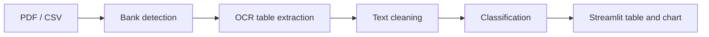

# Smart Expense Categorizer

An end-to-end system that extracts transactions from Indian bank statements using OCR and computer vision, then classifies each one with a hybrid rules, fuzzy matching and machine learning pipeline. Results are presented in a multi-user Streamlit application.


## Overview

Indian bank statements are inconsistent. Each bank uses a different layout, narrations wrap across lines, and UPI descriptions contain a lot of noise. A single hard-coded parser breaks when the format changes, and sending financial data to a cloud service is not always acceptable.

This project processes statements locally. It identifies the bank, extracts the transaction table with OCR, and categorizes every transaction using four cooperating engines. On the author's labelled dataset the classifier reached about 90% accuracy.

## Features

- **Bank detection:** IFSC code via OCR, OpenCV logo matching and a keyword fallback.
- **Template-based extraction:** per-bank column templates, with an auto-generated template for unknown banks.
- **Row-anchored OCR:** dates mark the start of each transaction, so multi-line narrations stay together.
- **Hybrid classification:** exact rules, fuzzy matching, a calibrated ML model and an optional Google Maps lookup.
- **Password-protected PDFs:** the app prompts for the password and unlocks the file.
- **Multi-user interface:** Streamlit app with signup and login backed by SQLite.

## Architecture



### Bank Detection

The IFSC code is read from the top 35% of page 1 using OCR. If that fails, the system tries OpenCV logo matching and then keywords. For an unknown bank, a template is built from the table's column headers.

### Table Extraction

Each page is rendered at 300 DPI. The date column is OCR-ed to find row boundaries, then the description and amount columns are OCR-ed per row. Split (debit/credit), merged (Dr/Cr) and amount-plus-type layouts are supported.

### Classification

Each description is cleaned, then four engines produce an opinion:

| Engine | Method | Score |
|---|---|---|
| Exact rules | Whole-word regex on keyword lists | 0.95 |
| Fuzzy match | RapidFuzz against all keywords, cutoff 85 | 0.80 |
| ML model | TF-IDF (1-3 grams) and scaled amount into a calibrated Random Forest, used when probability exceeds 0.5 | Model probability |
| Google Maps (optional) | Merchant name and city lookup via Places API | 0.99 |

A category supported by two or more engines receives a +0.2 boost, and the highest score wins. Every row keeps its `Method` and `Confidence`, so each decision can be traced. If the ML model cannot be loaded, the pipeline continues without it.

**Categories:** Food & Dining, Travel & Transport, Utilities & Bills, Shopping & E-commerce, Entertainment & OTT, Health & Wellness, Financial Obligations (EMI/Loans), Insurance, Investment & Wealth, Salary & Professional Income, Taxes & Government, Housing & Education, Transfers (Personal/UPI), Others.

**Supported statements:** Canara (`CNRB`), Janaseva Sahakari (`JSBL`), Kotak (`KKBK`), ICICI, PhonePe history, and any other bank through the dynamic fallback. Accepted inputs are PDF (digital, scanned or password-protected) and CSV.

## Project Structure

```text
Smart-Expense-Categorizer/
│
├── backend/
│   ├── Databases/
│   │   ├── database_setup.py       # creates users, raw_statements, expenses tables
│   │   └── database_manager.py     # create/verify user, save statement, update category
│   ├── file_handler/
│   │   ├── loader.py               # routes .pdf / .csv to the right loader
│   │   ├── pdf_load.py             # page rendering, row anchoring, per-column OCR
│   │   ├── csv_load.py             # CSV description-column detection
│   │   ├── bank_detector.py        # IFSC OCR, logo matching, keyword fallback
│   │   ├── bank_templates.py       # per-bank column templates + dynamic fallback
│   │   ├── pdf_to_images.py        # Poppler PDF-to-image helper (diagnostics only)
│   │   ├── diagnose_pdf.py         # inspect a PDF's tables and text
│   │   └── logos/                  # bank logos for template matching
│   ├── rules/
│   │   └── category_rules.py       # keyword lists for 13 categories
│   └── Scripts/
│       ├── preprocess.py           # text cleaning
│       ├── train_model.py          # trains and saves the calibrated pipeline
│       ├── predicted.py            # hybrid classifier, process_file(), CLI batch test
│       ├── test_bank_detector.py   # CLI check of bank detection on page 1
│       ├── diagnose_op.py          # PDF table/text inspection helper
│       └── model.pkl               # trained pipeline
│
├── Frontend/
│   ├── main.py                     # Streamlit entry point, auth state, navigation
│   ├── auth/                       # login.py, signup.py
│   └── pages/
│       ├── intro.py                # landing page
│       ├── dashboard.py            # upload, password prompt, analysis, recent files
│       ├── graph.py                # category distribution chart
│       └── history.py              # files analysed this session
│
└── assets/styles.css               # dark theme
```

## Getting Started

### Prerequisites

- Python 3.10 or higher
- [Tesseract OCR](https://github.com/tesseract-ocr/tesseract) (Windows: [UB-Mannheim build](https://github.com/UB-Mannheim/tesseract/wiki); Ubuntu: `sudo apt install tesseract-ocr`)

### Installation

```bash
git clone https://github.com/Khudbuddin/Smart-Expense-Categorizer.git
cd Smart-Expense-Categorizer

python -m venv venv
# Windows: venv\Scripts\activate
source venv/bin/activate

pip install streamlit streamlit-option-menu pandas numpy scikit-learn joblib \
            pdfplumber pdfminer.six pytesseract Pillow opencv-python rapidfuzz \
            nltk python-dotenv requests tabulate regex pdf2image
```

### Configuration

- Set the Tesseract path in `backend/file_handler/bank_detector.py` and `backend/file_handler/pdf_load.py` (`pytesseract.pytesseract.tesseract_cmd`). Both currently point to a local Windows path.
- Optional: add `GOOGLE_API_KEY=your_key` to a `.env` file to enable the Google Maps engine.

### Running the Application

```bash
python backend/Databases/database_setup.py   # creates storage.db
streamlit run Frontend/main.py
```

Open http://localhost:8501, create an account, upload a statement on the Dashboard page and run the analysis. The Graph page shows the category distribution.

### Additional Usage

**Batch mode.** Place a statement in `backend/data/`, set its file name at the bottom of `backend/Scripts/predicted.py`, and run `python backend/Scripts/predicted.py`. It prints the categorized table, the method breakdown and the net balance, and saves a CSV.

**Retraining the model.** Add `backend/data/training_data.csv` with the columns `Description`, `Amount` and `Category`, then run `python backend/Scripts/train_model.py`. Training uses an 80/20 stratified split and 3-fold cross-validation.

**Adding a bank.** Add an entry to `BANK_TEMPLATES` in `bank_templates.py`, keyed by the 4-letter IFSC prefix, with column pixel ranges (at 300 DPI) and an `amount_mode` of `split`, `merged` or `amount_type`.

## Roadmap

- Upload, Comparison, Insights and Profile pages
- Save categorized transactions to the `expenses` table with manual category correction
- Salted password hashing and an environment-based Tesseract path
- PNG/JPG uploads, `requirements.txt`, automated tests and more bank templates

## Privacy

Processing, OCR and classification run locally. The optional Google Maps step sends only the extracted merchant name and a city, never amounts or account details. Keep `storage.db`, bank statements and `.env` out of version control.

## Author

Khudbuddin Sayyad, B.Sc. Data Science & AI, Mumbai
[LinkedIn](https://linkedin.com/in/sayyad-khudbuddin) | [GitHub](https://github.com/Khudbuddin)
