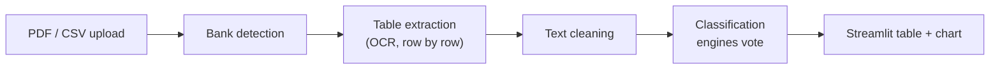

# Smart Expense Categorizer

> Upload an Indian bank statement (PDF or CSV) and get every transaction extracted and categorized automatically, using OCR, computer vision and a hybrid rules + fuzzy matching + ML classifier, delivered through a Streamlit app.

[](https://www.python.org/)
[](https://streamlit.io/)
[](https://scikit-learn.org/)
[](https://opencv.org/)
[](https://github.com/tesseract-ocr/tesseract)
[](https://www.sqlite.org/)

## Why this project exists

Every Indian bank formats its statement differently: different column positions, multi-line narrations and noisy UPI strings. One hard-coded parser breaks as soon as the layout changes, and many people don't want to send financial data to a cloud LLM.

This project runs locally and works in four steps:

1. **Identify the bank** from the statement (IFSC code, logo, keywords).
2. **Extract the transaction table** by rendering each page to an image and OCR-ing it row by row, using per-bank column templates.
3. **Categorize each transaction** with four cooperating engines.
4. **Show the results** in a multi-user Streamlit app.

## How it works



**Bank detection** (`bank_detector.py`): reads the IFSC code from the top 35% of page 1 using OCR. If that fails it tries OpenCV logo matching, then keywords. For an unknown bank, a template is built on the fly from the column headers.

**Table extraction** (`pdf_load.py`, `bank_templates.py`): each page is rendered at 300 DPI. The date column is OCR-ed to find where each transaction starts, and the space between two dates becomes that row's box, so multi-line narrations stay together. Description and amount columns are then OCR-ed separately. Split (debit/credit), merged (Dr/Cr) and amount + type layouts are supported. Output: `Date`, `Description`, `Type`, `Amount`.

**Classification** (`predicted.py`): descriptions are cleaned first (lowercase, digits and symbols removed, stop-words and noise like `upi` / `neft` dropped). Then four engines each give an opinion:

| Engine | How it decides | Score |
|---|---|---|
| Exact rules | Whole-word regex on keyword lists in `category_rules.py` | 0.95 |
| Fuzzy match | RapidFuzz against all keywords, cutoff 85 | 0.80 |
| ML model | TF-IDF (1-3 grams) + scaled amount → calibrated Random Forest, used if probability > 0.5 | model probability |
| Google Maps (optional) | Looks up the merchant name and city via the Places API | 0.99 |

If two or more engines agree, that category gets +0.2. The highest score wins, and anything unmatched becomes `Others`. Each row keeps its `Method` and `Confidence`, so every decision can be traced.

The ML model was trained on an 80/20 stratified split with 3-fold cross-validation and reached about **90% accuracy** on the author's labelled set (the training CSV is not included). If `model.pkl` can't be loaded, the app skips the ML engine and continues with the others.

**Categories (13 + Others):** Food & Dining, Travel & Transport, Utilities & Bills, Shopping & E-commerce, Entertainment & OTT, Health & Wellness, Financial Obligations (EMI/Loans), Insurance, Investment & Wealth, Salary & Professional Income, Taxes & Government, Housing & Education, Transfers (Personal/UPI).

**Supported statements:** Canara (`CNRB`), Janaseva Sahakari (`JSBL`), Kotak (`KKBK`), ICICI, PhonePe history, plus any other bank through the dynamic fallback. Inputs: PDF (digital, scanned or password-protected) and CSV.

## Project structure

```text
Smart-Expense-Categorizer/
├── backend/
│   ├── Databases/      # SQLite setup and user helpers
│   ├── file_handler/   # loaders, bank detection, bank templates, logos
│   ├── rules/          # category keyword rules
│   └── Scripts/        # preprocess, train_model, predicted (classifier + CLI), model.pkl
├── Frontend/
│   ├── main.py         # Streamlit entry point
│   ├── auth/           # login and signup
│   └── pages/          # intro, dashboard (upload + analysis), graph, history
└── assets/styles.css
```

## Getting started

**Prerequisites:** Python 3.10+ and [Tesseract OCR](https://github.com/tesseract-ocr/tesseract) (Windows: [UB-Mannheim build](https://github.com/UB-Mannheim/tesseract/wiki), Ubuntu: `sudo apt install tesseract-ocr`).

```bash
git clone https://github.com/Khudbuddin/Smart-Expense-Categorizer.git
cd Smart-Expense-Categorizer

python -m venv venv
# Windows: venv\Scripts\activate
source venv/bin/activate

pip install streamlit streamlit-option-menu pandas numpy scikit-learn joblib \
            pdfplumber pdfminer.six pytesseract Pillow opencv-python rapidfuzz \
            nltk python-dotenv requests tabulate regex pdf2image
```

**Configure**
- Set your Tesseract path in `backend/file_handler/bank_detector.py` and `backend/file_handler/pdf_load.py` (`pytesseract.pytesseract.tesseract_cmd`). Both currently point to a local Windows path.
- Optional: add `GOOGLE_API_KEY=your_key` to a `.env` file to enable the Maps engine.

**Run**
```bash
python backend/Databases/database_setup.py   # creates storage.db
streamlit run Frontend/main.py
```
Open http://localhost:8501, sign up, upload a statement on the Dashboard and click **Run Full Intelligence Analysis**. The Graph page shows the category chart.

**Batch mode:** put a statement in `backend/data/`, set its name at the bottom of `backend/Scripts/predicted.py`, and run `python backend/Scripts/predicted.py`.

**Retrain the model:** add `backend/data/training_data.csv` (`Description`, `Amount`, `Category`) and run `python backend/Scripts/train_model.py`.

**Add a bank:** add an entry to `BANK_TEMPLATES` in `bank_templates.py`, keyed by the 4-letter IFSC prefix, with column pixel ranges (at 300 DPI) and an `amount_mode` (`split`, `merged` or `amount_type`).

## Status and roadmap

**Working:** signup/login, PDF/CSV upload (including password-protected PDFs), bank detection, OCR extraction, 4-engine classification, category chart, CLI batch mode.

**Planned:**
- Upload, Comparison, Insights and Profile pages
- Save categorized transactions to the `expenses` table with manual category correction
- Salted password hashing
- Tesseract path via environment variable
- PNG/JPG uploads, `requirements.txt`, tests and more bank templates

## Privacy

Processing, OCR and classification run locally. The optional Maps step sends only the extracted merchant name and a city, never amounts or account details. Keep `storage.db`, statements and `.env` out of version control.

## Author

**Khudbuddin Sayyad** · B.Sc. Data Science & AI, Mumbai
[LinkedIn](https://linkedin.com/in/sayyad-khudbuddin) · [GitHub](https://github.com/Khudbuddin)
